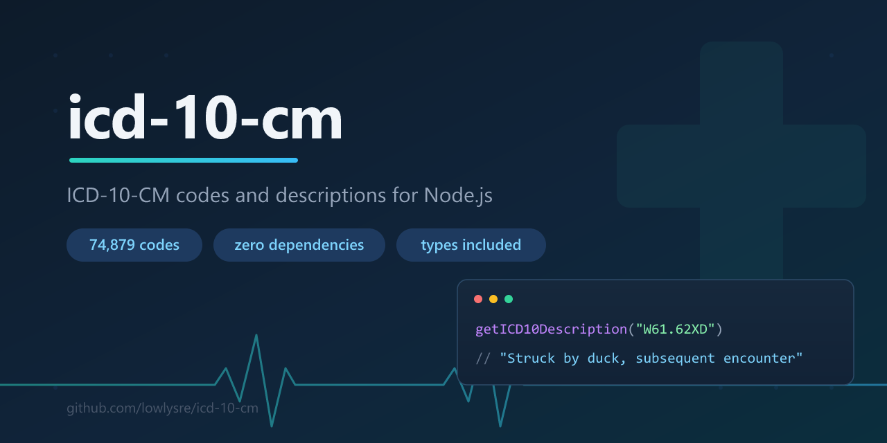

# icd-10-cm

  

ICD-10-CM diagnosis codes and descriptions as zero-dependency data packages, types included.

| Package                                         | Contents                                                                                                     |
| ----------------------------------------------- | ------------------------------------------------------------------------------------------------------------ |
| [@lowlysre/icd-10-cm](packages/icd-10-cm)       | The FY2027 ICD-10-CM codes and English descriptions from the CDC, effective October 1, 2026                  |
| [@lowlysre/icd-10-cm-es](packages/icd-10-cm-es) | The CIE-10-ES Spanish descriptions for those codes, from the Spanish Ministry of Health's 6th edition (2026) |

The packages don't depend on each other. Install one, or install both to show Spanish where it exists and English everywhere else. Each package's README covers its usage, API, and data source.

## Contributing

See [CONTRIBUTING.md](.github/CONTRIBUTING.md) for setup, the data update steps, and how releases work.
